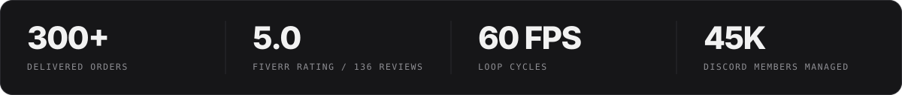

  

    

  

    <strong>Creative Technologist &amp; Character Rigger</strong> 
    Specializing in 2D puppet animation, high-scale Discord server architecture, and high-performance web engineering.
  

  

    <a href="https://faarrel.my.id/"><b>faarrel.my.id</b></a>
    &nbsp;&nbsp;·&nbsp;&nbsp;
    <a href="https://discord.com/users/938045579215380510"><b>Discord</b></a>
    &nbsp;&nbsp;·&nbsp;&nbsp;
    <a href="https://www.fiverr.com/faarrel"><b>Fiverr (5.0★)</b></a>
    &nbsp;&nbsp;·&nbsp;&nbsp;
    <a href="https://www.instagram.com/fxrrel_/"><b>Instagram</b></a>
    &nbsp;&nbsp;·&nbsp;&nbsp;
    <a href="mailto:muhammadfarrelyf@gmail.com"><b>Email</b></a>
  

   

  

    

  
<strong>Discord Activity</strong>

  

 

---

### Core Specialization

  

 

#### 1. 2D Character Animation &amp; Puppet Motion
- Transforming static anime artwork into loop cycles with After Effects puppet pins and mesh deformation.
- Multi-layer PSD separation across hair, eyes, facial expressions, and clothing physics.
- Custom Discord Nitro avatars, banners, and server assets exported at 60 FPS within platform file limits.

#### 2. Discord Systems &amp; Server Infrastructure
- Turnkey Discord guild architecture managing communities of 45,000 members.
- Custom bots built with `discord.js` and Python with fast event dispatch.
- Three-tier verification onboarding, anti-raid gates, and support ticket pipelines.

#### 3. Frontend Web Engineering
- Responsive web applications built with Next.js 16 (App Router), React 19, TypeScript, and Tailwind CSS v4.
- High-contrast typography and layout engineered to strict WCAG AA contrast standards.
- Kinetic interaction using GSAP, Framer Motion, and Lenis smooth scrolling.

---

### Tech Stack &amp; Tools

- **Creative &amp; Motion**: Adobe After Effects · Adobe Photoshop · Alight Motion · 60 FPS APNG / GIF
- **Web &amp; Frontend**: Next.js 16 (App Router) · React 19 · TypeScript · Tailwind CSS v4 · Framer Motion · GSAP
- **Discord &amp; Backend**: discord.js · Python · Node.js · Redis Cache · Webhook Pipelines

---

### Contact &amp; Profiles

- **Website**: [faarrel.my.id](https://faarrel.my.id/)
- **Discord**: [@faarrel](https://discord.com/users/938045579215380510) (ID: `938045579215380510`)
- **Fiverr**: [faarrel](https://www.fiverr.com/faarrel)
- **Instagram**: [@fxrrel_](https://www.instagram.com/fxrrel_/)
- **Email**: [muhammadfarrelyf@gmail.com](mailto:muhammadfarrelyf@gmail.com)
