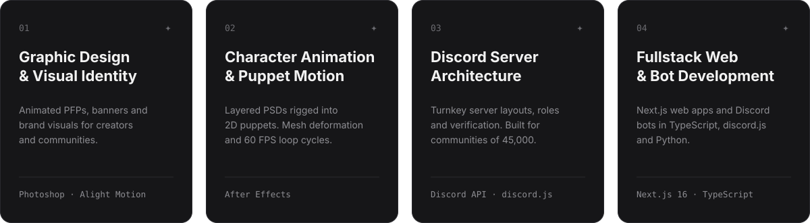

  

    

  

    <strong>Creative Technologist and Character Rigger</strong> 
    2D puppet animation, Discord community systems, and frontend web engineering.
  

  

    
    
    
    
    
  

   

  
<strong>Discord Activity</strong>

  

 

---

### Core Specialization

  

 

| Fact | Deliverable | Verification |
|---|---|---|
| **300 Completed Orders** | 5.0 rating across 136 client reviews | [Fiverr Portfolio](https://www.fiverr.com/faarrel) |
| **45,000 Guild Members** | Discord community infrastructure, 0 raid breaches | [Discord Architecture](https://discord.com/users/938045579215380510) |
| **100% Performance Score** | Next.js 16 App Router with sub-second response | [faarrel.my.id](https://faarrel.my.id/) |
| **60 FPS Puppet Motion** | High-definition loop cycles and PSD mesh deformation | [Portfolio Archive](https://github.com/Faarrel/Portfolio) |

---

### Work and Capabilities

#### 1. 2D Character Animation and Puppet Motion
- Transforming static 2D artwork into loop animations with After Effects puppet pins and mesh deformation.
- Multi-layer PSD separation across hair, eyes, facial expressions, and clothing physics.
- Custom Discord Nitro avatars, banners, and server assets exported at 60 FPS within platform file limits.

#### 2. Discord Engineering and Server Infrastructure
- Turnkey Discord guild architecture managing communities of 45,000 members.
- Custom bots built with `discord.js` and Python with fast event dispatch.
- Three-tier verification onboarding, anti-raid gates, and support ticket pipelines.

#### 3. Frontend Web Engineering
- Responsive web applications built with Next.js 16 (App Router), React 19, TypeScript, and Tailwind CSS v4.
- High-contrast typography and layout engineered to strict WCAG AA contrast standards.
- Motion layers using GSAP, Framer Motion, and Lenis smooth scrolling.

---

### Tools and Technologies

  
  
  
  
  
  
  
  

---

### GitHub Statistics

  
  &nbsp;
  

 

---

### Contact

- **Website**: [faarrel.my.id](https://faarrel.my.id/)
- **Discord**: [@faarrel](https://discord.com/users/938045579215380510) (ID: `938045579215380510`)
- **Fiverr**: [faarrel](https://www.fiverr.com/faarrel)
- **Instagram**: [@fxrrel_](https://www.instagram.com/fxrrel_/)
- **Email**: [muhammadfarrelyf@gmail.com](mailto:muhammadfarrelyf@gmail.com)
