  

    

  

    <strong>Creative Technologist &amp; Character Rigger</strong> 
    2D puppet animation, Discord community systems, and frontend web engineering.
  

  

    <a href="https://faarrel.my.id/"><strong>Website</strong></a>
    &nbsp;&nbsp;·&nbsp;&nbsp;
    <a href="https://discord.com/users/938045579215380510"><strong>Discord (@faarrel)</strong></a>
    &nbsp;&nbsp;·&nbsp;&nbsp;
    <a href="https://www.fiverr.com/faarrel"><strong>Fiverr (5.0★)</strong></a>
    &nbsp;&nbsp;·&nbsp;&nbsp;
    <a href="https://www.instagram.com/fxrrel_/"><strong>Instagram</strong></a>
    &nbsp;&nbsp;·&nbsp;&nbsp;
    <a href="mailto:muhammadfarrelyf@gmail.com"><strong>Email</strong></a>
  

   

  

 

---

### Core Specialization

  

 

---

### Verified Track Record

- **Motion Design & 2D Rigging:** 300+ completed client orders on Fiverr with a 5.0 rating across 136 reviews. Specializing in 60 FPS loop cycles, multi-layer PSD separation, and puppet mesh deformation.
- **Discord Community Infrastructure:** Turnkey server architecture managing communities of 45,000 members with 0 raid breaches. Custom event-driven bots written in `discord.js` and Python.
- **Frontend Web Engineering:** Modern web applications built with Next.js 16 (App Router), React 19, TypeScript, and Tailwind CSS v4, achieving a 100% Lighthouse performance score.

---

### Tools & Technologies

| Discipline | Stack & Tools |
|---|---|
| **Animation & Motion** | Adobe After Effects · Adobe Photoshop · Alight Motion · 60 FPS Loop Cycles |
| **Frontend Development** | Next.js 16 (App Router) · React 19 · TypeScript · Tailwind CSS v4 · Framer Motion |
| **Discord & Backend** | Discord.js · Discord API · Python · Node.js · Security & Verification Systems |

---

### Contact & Collaboration

- **Website**: [faarrel.my.id](https://faarrel.my.id/)
- **Discord**: [@faarrel](https://discord.com/users/938045579215380510) (ID: `938045579215380510`)
- **Fiverr**: [faarrel](https://www.fiverr.com/faarrel) (5.0★ Rating)
- **Instagram**: [@fxrrel_](https://www.instagram.com/fxrrel_/)
- **Email**: [muhammadfarrelyf@gmail.com](mailto:muhammadfarrelyf@gmail.com)
